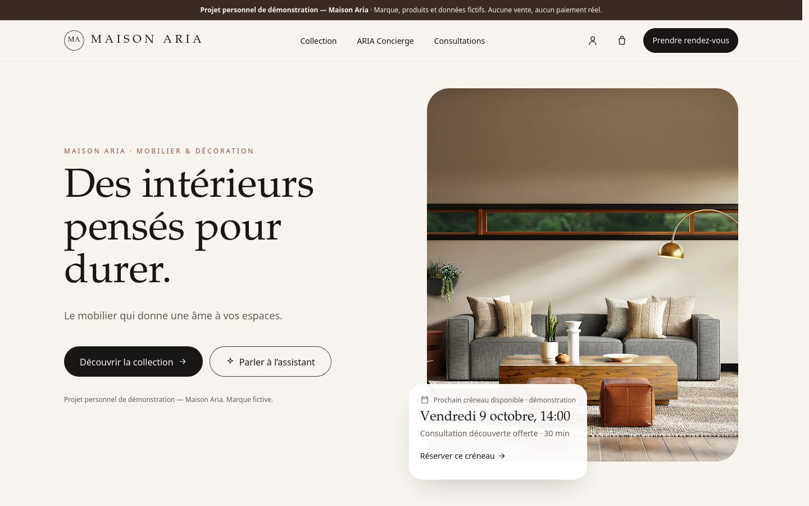

# Maison Aria

[](https://github.com/sianahk22/maison-aria/actions/workflows/ci.yml)

> ⚠️ **Projet personnel de démonstration — Maison Aria.**
> Maison Aria est une **marque fictive**. Produits, prix, consultants, commandes, réservations et
> statistiques sont inventés. Aucun produit n'est vendu, aucun paiement n'est effectué, aucun
> rendez-vous réel n'est créé. L'assistant ARIA fonctionne en **mode simulé** tant qu'aucune clé
> d'API Anthropic n'est configurée sur le serveur (c'est le cas de la démo publique, voir plus bas).
> Ce projet ne représente aucun client ni aucune entreprise réelle.

**Plateforme e-commerce, réservation et assistant intelligent pour une marque fictive de décoration
intérieure** : boutique, panier, réservation de consultations avec prévention des doubles
réservations, assistant de recommandation ARIA Concierge, espace client et tableau de bord.



**🔗 Démo en ligne : https://maison-aria.vercel.app** · Code source : https://github.com/sianahk22/maison-aria

## Sommaire

- [Fonctionnalités](#fonctionnalités)
- [Technologies](#technologies)
- [Lancer le projet](#lancer-le-projet)
- [Architecture](#architecture)
- [ARIA Concierge : mode simulé et IA réelle](#aria-concierge--mode-simulé-et-ia-réelle)
- [Variables d'environnement](#variables-denvironnement)
- [Images](#images)
- [Qualité : tests, accessibilité, performance](#qualité--tests-accessibilité-performance)
- [Déployer sur Vercel](#déployer-sur-vercel)
- [Limites actuelles](#limites-actuelles)
- [Prochaines évolutions](#prochaines-évolutions)

## Fonctionnalités

| Page | Route | Contenu |
| --- | --- | --- |
| Accueil | `/` | Hero éditorial, carte « prochain créneau disponible » calculée en direct, sélection de produits, services, aperçus consultation et ARIA, prochains créneaux, appel à l'action |
| Collection | `/shop` | Recherche (nom, matériaux, catégorie…), filtres catégorie et prix, tri ; filtres conservés dans l'URL ; états chargement, vide et erreur |
| Fiche produit | `/shop/:productId` | Galerie (vue d'ensemble et rapprochée), prix, disponibilité, dimensions, matériaux, délai indicatif, quantité, produits similaires, « Demander conseil à ARIA Concierge » |
| Panier | `/cart` | Ajout, quantité, suppression, sous-total, livraison, total ; conservé après rechargement ; écran de commande : « Le paiement n'est pas connecté dans cette démonstration. » |
| Réservation | `/booking` | Service, consultant·e fictif·ve, visio ou boutique, date, créneau, coordonnées, récapitulatif, confirmation ; modification et annulation |
| ARIA Concierge | `/concierge` | Conversation, questions rapides, état de réflexion, recommandations expliquées vers les fiches produits, proposition de consultation |
| Espace client | `/account` | Rendez-vous à venir (modifier, annuler), historique, commandes fictives, recommandations — sans authentification réelle |
| Tableau de bord | `/admin` | Réservations du jour, prochaines consultations, calendrier 7 jours, statuts, produits consultés, demandes à ARIA, commandes fictives — « Données de démonstration » |
| 404 | `/404`, toute URL inconnue | Page introuvable, navigation conservée |

### Règles de réservation

- Les créneaux sont **calculés** à partir des horaires des consultants, jamais stockés.
- Aucun créneau passé ni à moins de 2 h ; créneaux pris affichés barrés et non sélectionnables.
- Chevauchement : `début A < fin B` **et** `début B < fin A`.
- **Double-clic** : bouton désactivé + verrou synchrone + **clé d'idempotence** (une même demande
  envoyée deux fois ne crée qu'une réservation).
- **Deuxième vérification au moment de confirmer**, car un créneau peut être pris entre son
  affichage et la confirmation. Le bouton « Simuler une réservation concurrente » le démontre.
- Un même client ne peut pas avoir deux rendez-vous qui se chevauchent.
- Fuseau Europe/Paris géré avec l'API `Intl` (changements d'heure inclus) ; stockage en UTC.

## Technologies

| Outil | Rôle |
| --- | --- |
| [Vite](https://vite.dev) 8 | Serveur de développement et build |
| React 19 | Interface (`use`, `Suspense`, `useSyncExternalStore`, `<title>` natif) |
| React Router 8 | Navigation, pages chargées à la demande, frontières d'erreur |
| Tailwind CSS 4 | Styles et tokens de design |
| ESLint 10 | Qualité du code (dont les règles React Hooks) |
| `node:test` | Tests unitaires, intégrés à Node (aucune dépendance) |
| `@anthropic-ai/sdk` | SDK officiel Anthropic, utilisé **uniquement côté serveur** (`server/`, `api/`) — jamais envoyé au navigateur |
| Vercel Functions | Fonction serverless `api/concierge.js` (ARIA en mode IA réelle) |

Aucune autre dépendance : l'état partagé, les icônes, les dates et les graphiques reposent sur de
petits modules maison documentés. (`react-router-dom` n'est pas nécessaire : depuis la v7, c'est un
alias de `react-router`.)

## Lancer le projet

Prérequis : **Node.js 22.22 ou plus récent** (exigé par React Router 8).

```bash
npm install
npm run dev        # http://localhost:5173
```

| Commande | Rôle |
| --- | --- |
| `npm run dev` | Serveur de développement |
| `npm run build` | Build de production dans `dist/` |
| `npm run preview` | Sert le build de production en local |
| `npm run lint` | Vérification ESLint |
| `npm test` | Tests unitaires : logique métier, garde-fou et serveur d'ARIA, catalogue, images |
| (automatique) | GitHub Actions lance lint, tests et build à chaque push (`.github/workflows/ci.yml`) |
| `npm run test:e2e` | Tests de bout en bout dans Firefox (parcours + audit 10 routes × 5 largeurs). Prérequis : Firefox installé et `npm run build` fait. Contre le site en ligne : `E2E_BASE_URL=https://maison-aria.vercel.app npm run test:e2e` |

## Architecture

```
src/
├── app/            # routeur, chemins (ROUTES), identité de marque et mentions de démo
├── pages/          # une page par route : assemble des composants, sans logique métier
├── features/       # code par fonctionnalité
│   ├── products/   #   cartes, filtres (logique pure : productFiltering.js), galerie
│   ├── cart/       #   logique pure (cartLogic.js), store, lignes, modale de commande
│   ├── booking/    #   créneaux et conflits (availability.js), fuseau (time.js), formulaire
│   ├── concierge/  #   interface du chat, cartes de recommandation, journal local
│   ├── account/    #   carte de rendez-vous (modifier / annuler)
│   ├── admin/      #   calculs du tableau de bord (dashboardStats.js), widgets
│   └── home/       #   sections de la page d'accueil
├── components/     # composants génériques : ui/ (Button, Modal, Field…) et layout/ (Header, Footer…)
├── services/       # accès aux données — seuls fichiers à remplacer pour une vraie API
│   └── aria/       #   fournisseur simulé et garde-fou des réponses d'ARIA
├── data/           # données fictives : produits, images, consultations, statistiques
├── lib/            # utilitaires : store, formatage, images, moteur de recommandation
└── styles/         # tokens de design (@theme Tailwind)
api/concierge.js    # fonction serverless Vercel : GET (mode actif) et POST (réponse d'ARIA)
server/             # logique serveur d'ARIA (clé lue ici uniquement, validation, limite de débit)
tests/              # tests unitaires (npm test) ; tests/e2e/ : tests navigateur (npm run test:e2e)
public/images/      # images locales (WebP) + CREDITS.md
```

- **Logique pure** (sans React, testée) : `cartLogic`, `productFiltering`, `availability`, `time`,
  `recommendationEngine`, `dashboardStats`, `responseGuard`.
- **Services asynchrones** : `productService`, `bookingService`, `conciergeService`. Ils simulent la
  latence réseau ; pour passer en production, on remplace leur contenu par des appels HTTP sans
  toucher aux pages.
- **État partagé** : `lib/createStore.js` + `useSyncExternalStore`, avec persistance `localStorage`
  versionnée et validée, et synchronisation entre onglets.
- **Erreurs** : une page en erreur s'affiche sous l'en-tête (navigation conservée), avec « Réessayer ».

## ARIA Concierge : mode simulé et IA réelle

ARIA fonctionne selon deux modes, et **l'interface affiche toujours celui qui répond** :

| Mode | Quand | Fonctionnement |
| --- | --- | --- |
| **Simulé** (démo publique actuelle) | Aucune clé configurée, en local, ou si l'IA échoue | Moteur de règles local (`src/lib/recommendationEngine.js`) : mots-clés → score → raison. Le message ne quitte pas le navigateur. |
| **IA réelle** | `ANTHROPIC_API_KEY` définie sur Vercel | Le navigateur appelle `POST /api/concierge` ; le serveur interroge Claude (Anthropic) et renvoie une réponse vérifiée. |

| Rôle | Fichier |
| --- | --- |
| Interface du chat | `src/features/concierge/ConciergeChat.jsx` |
| Service (choix du mode, repli automatique, limite de 500 caractères) | `src/services/conciergeService.js` |
| Fournisseurs : IA via le serveur / règles locales | `src/services/aria/remoteProvider.js` / `simulatedProvider.js` |
| Garde-fou appliqué à toute réponse (navigateur **et** serveur) | `src/services/aria/responseGuard.js` |
| Fonction serverless et logique serveur | `api/concierge.js`, `server/ariaConcierge.js` |

**Sécurité du mode IA**

- La clé n'est lue que par le serveur ; elle n'est jamais envoyée au navigateur ni stockée dans le dépôt.
- Réponse **contrainte par un schéma JSON** (`output_config.format`) : les identifiants de produits
  sont limités à ceux du catalogue, puis le garde-fou écarte tout produit inconnu, tronque les textes
  et rejette les intentions inconnues.
- Le message du visiteur est balisé (`<demande_client>`) et traité comme une donnée, jamais comme
  une consigne (*prompt injection*).
- Validation côté serveur (1 à 500 caractères, corps limité), **limite de débit** de 6 messages par
  minute et 40 par jour et par adresse IP (en mémoire, par instance : limite « au mieux »).
- Aucun contenu de message ni secret n'est écrit dans les journaux ; les erreurs renvoient un
  message générique et le site repasse en mode simulé.
- **ARIA ne réserve, ne paie et ne décide jamais d'une disponibilité** : elle peut seulement suggérer
  une consultation ; la réservation reste contrôlée par `bookingService`.
- Modèle par défaut `claude-opus-5-5` (effort `low`, repli serveur automatique en cas de refus),
  modifiable avec `ARIA_AI_MODEL` (ex. `claude-haiku-5-5`, nettement moins coûteux).

> ⚠️ Le mode IA réelle est **implémenté et testé avec un faux client** (`tests/ariaServer.test.js`),
> mais **n'a pas été exécuté avec une vraie clé** dans cette version. Avant de l'activer sur un site
> public : fixer une limite de dépense dans la console Anthropic, puis tester quelques échanges.

## Variables d'environnement

**Aucune variable n'est nécessaire** : sans elles, le site fonctionne entièrement en démonstration.
Voir [`.env.example`](.env.example) (aucune vraie valeur).

| Variable | Où | Rôle |
| --- | --- | --- |
| `ANTHROPIC_API_KEY` | Vercel → Settings → Environment Variables (ou `.env.local` ignoré par Git) | Active ARIA en mode IA réelle. **Secrète** : jamais dans le code, jamais préfixée par `VITE_`. |
| `ARIA_AI_MODEL` | idem (facultatif) | Modèle Claude utilisé. Défaut : `claude-opus-5-5`. |

## Images

- **Locales** dans `public/images/` (WebP, 2 largeurs + vue rapprochée par produit), déclarées dans
  `src/data/images.js` avec un texte alternatif décrivant ce qu'on voit réellement.
- Chargement différé (`loading="lazy"`) hors image principale, `srcset` adapté à l'écran, **image de
  secours** si un fichier manque.
- Ce sont des **photos d'illustration Unsplash** (licence Unsplash), sans personne identifiable ni
  marque visible. Elles **ne représentent pas de vrais produits** et doivent être remplacées avant
  tout usage commercial réel. Sources et limites : [`public/images/CREDITS.md`](public/images/CREDITS.md).

## Qualité : tests, accessibilité, performance

- **`npm test`** (38 tests) : panier, créneaux et fuseau horaire, service de réservation
  (double-clic, conflit, concurrence, modification, annulation), moteur, garde-fou et serveur
  d'ARIA (avec un faux client Anthropic), catalogue et existence des images.
- **`npm run test:e2e`** (49 vérifications, Firefox piloté via WebDriver BiDi, sans dépendance) :
  parcours boutique, panier, réservation, ARIA, compte, tableau de bord ; clavier ; audit de
  10 routes × 5 largeurs (360, 390, 768, 1024, 1440 px) : pas de défilement horizontal, un `h1`,
  images avec `alt`, champs libellés, aucune erreur console.
- **Accessibilité** : HTML sémantique, un `h1` par page, lien « Aller au contenu », formulaires
  libellés et erreurs reliées aux champs, vrais boutons radio, modales `<dialog>` natives, focus
  visible, contrastes WCAG AA vérifiés, réglage « réduire les animations » respecté.
- **Performance** (mesure locale) : environ 210 Ko transférés pour l'accueil sur mobile, dont
  115 Ko de JavaScript ; pages chargées à la demande ; aucune requête externe.

## Déployer sur Vercel

Le dépôt contient [`vercel.json`](vercel.json) : il renvoie toutes les URL (sauf `/api/…`) vers
`index.html` (sinon, ouvrir directement `/shop` donnerait une erreur 404), ajoute des en-têtes de
sécurité et un cache long pour les fichiers versionnés. La fonction `api/concierge.js` est détectée
automatiquement.

1. Pousser le projet sur GitHub.
2. Sur [vercel.com](https://vercel.com) : *Add New → Project*, importer le dépôt.
3. Réglages détectés automatiquement : *Framework* Vite, *Build* `npm run build`, *Output* `dist`.
4. Aucune variable n'est obligatoire. Pour activer l'IA réelle d'ARIA : ajouter `ANTHROPIC_API_KEY`
   (et éventuellement `ARIA_AI_MODEL`), puis redéployer.
5. Si l'adresse publique change, mettre à jour `og:url` et `og:image` dans `index.html`
   (aperçus de partage). Démo actuelle : https://maison-aria.vercel.app — redéployée à chaque push sur `main`.

## Limites actuelles

- **Pas de vrai paiement** : l'écran de commande indique que le paiement n'est pas connecté.
- **IA réelle non activée sur la démo publique** (pas de clé configurée) : ARIA fonctionne par
  mots-clés et ne comprend pas les phrases complexes. Le mode IA est prêt mais non testé avec une vraie clé.
- **Pas d'authentification** : profil fictif ; « mes rendez-vous » = ceux créés dans ce navigateur.
- **Pas de base de données** : tout est dans le `localStorage` du navigateur. La prévention des
  doublons démontre la logique, mais seule une base côté serveur (contrainte d'exclusion dans une
  transaction) la garantit entre plusieurs utilisateurs.
- **Aucun email** envoyé. Application monopage : référencement limité. Polices système.
- Limite de débit de l'IA en mémoire (par instance serverless), donc non globale.

## Prochaines évolutions

1. Intégration continue (GitHub Actions : lint, tests, build) ; limite de débit partagée (Redis/KV).
2. Backend serverless + PostgreSQL : catalogue, réservations avec contrainte anti-chevauchement.
3. Authentification via un fournisseur reconnu ; espace client réel.
4. Paiement via un prestataire (ex. Stripe Checkout) appelé côté serveur.
5. Activer l'IA réelle d'ARIA avec une clé et un budget, puis mesurer qualité et coût.
6. Emails de confirmation, vraies photos produits, police éditoriale auto-hébergée.

---

Projet personnel de démonstration — Maison Aria. Photos d'illustration : [Unsplash](https://unsplash.com).
